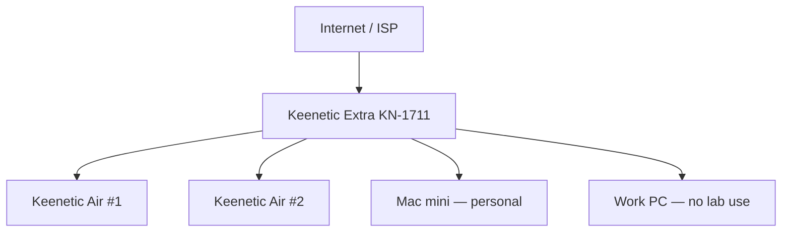
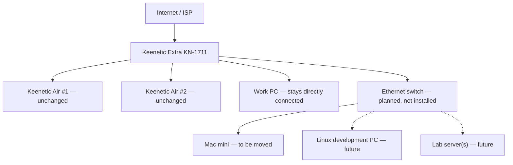

# Home lab network — physical links and separation

> **Status:** physical As-Is reported on 2026-10-16.
> **Proposed** wiring choice confirmed on 2026-10-16; not yet installed.
> No addressing, SSIDs, credentials, or employer-specific network settings
> belong in this public repository.

## As-Is — four occupied LAN connections

The ISP feeds **Keenetic Extra KN-1711**. It has wired connections to two
**Keenetic Air** devices in other rooms, the **Mac mini**, and the **work PC**.
The four LAN connections are occupied. The ISP/WAN link is separate from those
four connections.

This diagram shows **physical connections**, not VLAN membership or the Air
devices' operating modes. Those details have not been verified.

## Proposed — selected wiring (decision 2026-10-16; not deployed)

**Decision:** keep the two Keenetic Air devices **and the work PC directly
connected to Keenetic Extra**. Use the Mac mini's former direct LAN connection
as the single Extra–switch uplink. Connect the Mac mini and future lab devices
to the switch. Four Extra LAN ports remain occupied: Air #1, Air #2, work PC,
and the switch uplink; **no Extra LAN port becomes free**.

**Reason:** if the future switch is powered off, reconfigured, or fails, the
work PC's *physical* route to Extra does not depend on that switch. This is not
full network isolation: the work PC, the home LAN, and the lab may still share
the router and Layer-3 connectivity. **No changes to the work PC** are part of
this plan, and this decision does not constitute installation approval.

### Alternative considered — not selected

Connecting **both** the Mac mini and work PC behind the switch would leave
one Extra LAN port free, but would make the work PC dependent on the new switch
for its wired network connection. This is **not** the selected topology.
Revisit it only with a separate explicit decision; no second full diagram is
needed for current installation planning.

## Capacity and security constraints

- The KN-1711 has **100 Mbit/s Ethernet ports** according to the
  [Keenetic KN-1711 specifications](https://keenetic.com/en/keenetic-carrier-kn-1711).
  The single Extra–switch uplink is therefore **at most 100 Mbit/s**. Every
  device behind the switch shares that uplink for traffic crossing Extra;
  installing a faster switch does not raise the uplink speed.
- Devices within the **same VLAN/subnet** can exchange traffic directly
  through a Gigabit or 2.5GbE switch at their negotiated port speeds,
  subject to endpoints, cabling, and workloads; such traffic need not pass
  through the KN-1711 uplink.
- A candidate is an **8–16-port managed switch** with 802.1Q VLAN support
  and at least 1GbE access ports. These are design criteria, not a selected
  model or approved purchase.
- A VLAN by itself is not an inter-network firewall. Before permitting a
  separate experimental VLAN, identify its gateway, routes, DHCP, DNS,
  IPv4/IPv6 firewall policy, and which home resources must be unreachable.
  **Do not assume KN-1711 can implement any particular multi-VLAN topology**
  without testing its exact hardware/software.
- One switch-to-Extra uplink is sufficient in this design. Do not connect
  several unconfigured parallel links and accidentally create an L2 loop.
- Physical isolation from a failed switch and logical isolation from lab
  traffic are **different properties**. A work PC directly connected to
  Extra is not automatically protected from all other LAN hosts.

## Safe migration / verification checklist (not executed)

1. Record a sanitized port map and preserve a private, restorable router
   configuration **outside Git**. Check switch power and cable quality.
2. Install the switch with one uplink to Extra. Initially migrate **only
   the Mac mini**; confirm link negotiation, DHCP, gateway, DNS and internet.
3. Verify expected same-switch LAN throughput separately from internet
   throughput; explicitly note the KN-1711's 100 Mbit/s uplink.
4. Test switch power loss and the rollback cable path. **Leave the work PC
   directly on Extra**; changes to its connection are outside this plan.
5. Before creating experimental VLANs, write and test a deny-by-default
   boundary in a disposable setup; do not experiment on the home's live
   connectivity or employer equipment.
6. Update the As-Is diagram and evidence **only after physical verification**.

## Pending confirmation

- Switch model, access-port count, placement, and current cable paths.
- Actual link negotiation and router port configuration; Air operating modes.
- Gateway/firewall solution for isolated lab networks and safe fallback.

