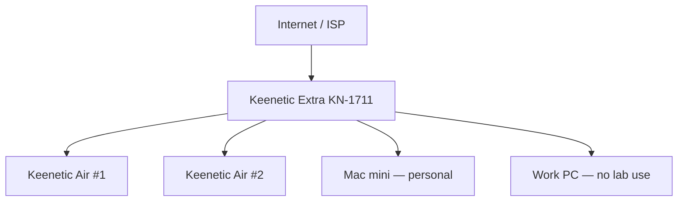
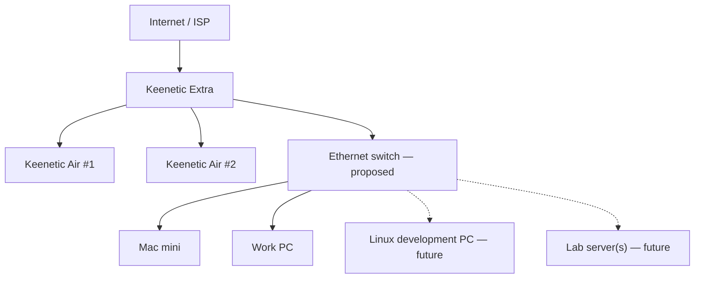
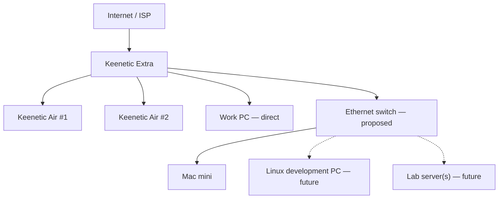

# Home lab network — physical links and separation

> **Status:** physical As-Is reported on 2026-10-16.
> **Proposed** diagrams are options, not deployed topology.
> No addressing, SSIDs, credentials, or employer-specific network settings
> belong in this public repository.

## As-Is — four occupied LAN connections

The ISP feeds **Keenetic Extra KN-1711**. It has wired connections to two
**Keenetic Air** devices in other rooms, the **Mac mini**, and the **work PC**.
The four LAN connections are occupied. The ISP/WAN link is separate from those
four connections.

This diagram shows **physical connections**, not VLAN membership or the Air
devices' operating modes. Those details have not been verified.

## Proposed option A — user-requested switch layout

Leave the two Air connections as they are. Connect **one** Extra LAN port to an
Ethernet switch, then connect Mac mini, work PC, and future lab equipment to
that switch. Three Extra LAN links are used, leaving one free.

**Trade-off:** simple cabling and a spare Extra LAN port; the work PC depends
on the new switch remaining available for its wired connection.

## Proposed option B — retain work-PC direct connection

Leave the work PC attached directly to Extra and use the Mac mini's former
Extra LAN port as the switch uplink. Four Extra LAN ports remain occupied:
Air #1, Air #2, work PC and switch. Future development/lab devices join the
Mac mini behind the switch.

**Trade-off:** a switch outage does not itself disconnect the work PC from
Extra; no spare Extra LAN port remains. This is a **recommendation to assess**,
not an approved change. Both options still share Extra and the home internet
connection. Neither option means the work PC participates in experiments.

## Capacity and security constraints

- The KN-1711 has **100 Mbit/s Ethernet ports** according to the
  [Keenetic KN-1711 specifications](https://keenetic.com/en/keenetic-carrier-kn-1711).
  The single Extra–switch uplink is therefore **at most 100 Mbit/s**. Every
  device behind the switch shares that uplink for traffic crossing Extra;
  installing a faster switch does not raise the uplink speed.
- Devices within the **same VLAN/subnet** can exchange traffic directly
  through a Gigabit or 2.5GbE switch at their negotiated port speeds,
  subject to endpoints, cabling, and workloads; such traffic need not pass
  through the KN-1711 uplink.
- A candidate is an **8–16-port managed switch** with 802.1Q VLAN support
  and at least 1GbE access ports. These are design criteria, not a selected
  model or approved purchase.
- A VLAN by itself is not an inter-network firewall. Before permitting a
  separate experimental VLAN, identify its gateway, routes, DHCP, DNS,
  IPv4/IPv6 firewall policy, and which home resources must be unreachable.
  **Do not assume KN-1711 can implement any particular multi-VLAN topology**
  without testing its exact hardware/software.
- One switch-to-Extra uplink is sufficient in this design. Do not connect
  several unconfigured parallel links and accidentally create an L2 loop.
- Physical isolation from a failed switch and logical isolation from lab
  traffic are **different properties**. A work PC directly connected to
  Extra is not automatically protected from all other LAN hosts.

## Safe migration / verification checklist (not executed)

1. Record a sanitized port map and preserve a private, restorable router
   configuration **outside Git**. Check switch power and cable quality.
2. Install the switch with one uplink to Extra. Initially migrate **only
   the Mac mini**; confirm link negotiation, DHCP, gateway, DNS and internet.
3. Verify expected same-switch LAN throughput separately from internet
   throughput; explicitly note the KN-1711's 100 Mbit/s uplink.
4. Test switch power loss and the rollback cable path. Keep the work PC
   direct until there is a reason and permission to move its connection.
5. Before creating experimental VLANs, write and test a deny-by-default
   boundary in a disposable setup; do not experiment on the home's live
   connectivity or employer equipment.
6. Update the As-Is diagram and evidence **only after physical verification**.

## Pending confirmation

- Work PC direct (option B) versus behind switch (option A).
- Switch model, access-port count, placement, and current cable paths.
- Actual link negotiation and router port configuration; Air operating modes.
- Gateway/firewall solution for isolated lab networks and safe fallback.

